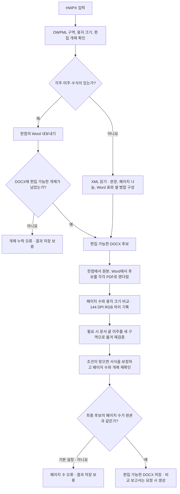
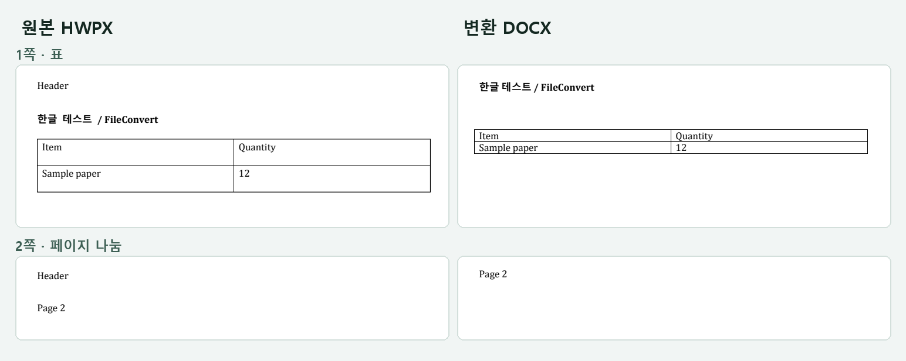
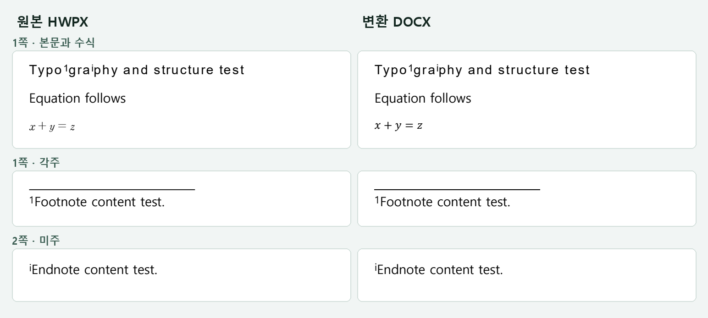

# FileConvert Skill

<p>
  <a href="SKILL.md"></a>
  <a href="#claude-code와-codex에-설치"></a>
  <a href="#claude-code와-codex에-설치"></a>
  <a href="#claude-code와-codex에-설치"></a>
  <a href="#사용한-스킬"></a>
</p>

HWPX, HWP, Word, PDF, PowerPoint 문서를 로컬에서 양방향으로 변환하고 렌더링 결과를 비교하는 Claude Code와 Codex용 문서 변환 스킬입니다.

| 변환 경로 | 변환 방식 |
| --- | --- |
| HWPX ↔ DOCX | HWPX XML의 본문과 표를 Word 문서로 구성합니다. DOCX에서 시작하면 한글 문서로 저장합니다. |
| HWP ↔ DOCX | HWP 5.0의 본문과 표를 Word 문서로 구성합니다. DOCX에서 시작하면 한글 문서로 저장합니다. |
| PDF ↔ HWPX, PDF ↔ HWP | PDF의 내용과 배치를 한글 문서로 가져옵니다. 한글 문서에서 시작하면 PDF로 내보냅니다. |
| PDF ↔ DOCX, PDF ↔ DOC | PDF의 본문과 배치를 Word 문서로 재구성합니다. Word 문서에서 시작하면 PDF로 내보냅니다. |
| PDF ↔ PPTX, PDF ↔ PPT | PowerPoint PDF 내보내기. PDF에서 시작하면 페이지별 이미지를 슬라이드에 배치 |
| DOC → DOCX | Microsoft Word에서 DOCX로 저장 |
| HWP → HWPX | 한컴 한글에서 HWPX로 저장 |

Windows 데스크톱, Python 3.13(검증 버전)과 경로별로 설치·활성화된 한컴오피스 한글 및 Microsoft Word·PowerPoint가 필요합니다. PDF → PPTX 후보 생성과 HWPX 구조 추출은 Python으로 처리하지만 전체 CLI 검증에는 해당 오피스 앱이 필요합니다. Hancom 파일 접근 대화상자가 뜨는 환경에서는 한컴 공식 문서에 따라 등록한 경로 확인 모듈 이름을 `FILECONVERT_HANCOM_PATH_MODULE`에 지정할 수 있습니다.

```powershell
python -m pip install -r requirements.txt
python scripts/convert.py --list
python scripts/convert.py input.hwpx output.docx --report comparison.json
```

CLI는 각 페이지의 크기와 144 DPI RGB 픽셀을 비교합니다. HWPX → DOCX는 페이지 수가 같으면 외형 차이가 있어도 저장합니다. 다른 경로의 기본 설정과 `--require-visual-match`는 용지 크기와 픽셀 일치까지 요구합니다. 일치 조건을 충족하지 못하면 종료 코드 2를 반환합니다. `--allow-differences`는 페이지 수가 같을 때 외형 차이를 허용하며, 편집 가능한 문서의 페이지 수도 달라질 수 있으면 `--allow-page-count-change`를 함께 사용합니다. PDF → HWP/HWPX는 원본과 같은 페이지 수를 요구합니다. 코드 1은 변환 또는 검증 실패입니다. 동일 판정은 실행 환경과 렌더링 설정에 한정됩니다.

## HWPX → DOCX 파이프라인



그림은 추가 옵션 없이 실행했을 때의 흐름입니다. 지원하는 그림 참조와 문자 서식도 XML에서 읽습니다. `--hwpx-structure`를 사용하는 기존 명령도 지원합니다.

| 편집 개체 | DOCX에서 유지하는 방식 |
| --- | --- |
| 표 | XML 경로에서 Word 표의 행·열과 셀 병합을 구성합니다. 각주·미주·수식이 함께 있어 한컴 경로를 쓰는 경우에는 내보낸 DOCX에도 Word 표가 남았는지 확인합니다. |
| 각주·미주 | Word의 참조 표시와 연결된 각주·미주 본문으로 내보냅니다. 변환기는 원본의 개체 수를 기준으로 DOCX의 참조가 실제 본문에 연결되는지 확인합니다. |
| 수식 | Word 수식 편집기에서 수정할 수 있는 OMML 수식으로 내보내고 개수를 확인합니다. 원본 수식의 크기와 정렬을 적용할 수 있으며, 글꼴에 따라 글자 모양에 차이가 남을 수 있습니다. |

### 페이지 수와 렌더링 검증

1. 원본 HWPX와 Word에서 렌더링한 후보의 페이지 수를 비교합니다. 원본의 문서 끝 미주가 Word에서 본문과 같은 쪽으로 합쳐져 페이지가 줄어든 경우, 새 구역을 추가한 후보를 다시 렌더링합니다. 원본 페이지 수와 편집 가능한 개체가 유지될 때 그 후보를 채택합니다.
2. 각주·미주·수식이 있는 단일 구역 문서에서 대응하는 줄을 찾으면 자간, 줄 위치, 각주 구분선과 수식 배치를 보정합니다. 페이지 수와 편집 개체가 유지되고 픽셀 차이 합계가 줄어든 후보를 사용합니다.
3. 기본 설정은 원본과 같은 페이지 수를 요구합니다. `--report comparison.json`을 지정하면 원본·결과의 페이지 수, 용지 크기와 렌더링 비교 결과를 기록합니다. 픽셀 일치까지 요구하려면 `--require-visual-match`를 사용합니다.

한컴 PDF가 원본 용지보다 조금 작으면 HWPX에 기록된 용지 크기로 비교 영역을 복원하고, PDF가 내보낸 크기는 `source_render_size_pt`에 남깁니다. 보정 전후의 픽셀 차이 합계는 `hwpx_rgb_error_before`와 페이지별 `rgb_error`로 비교할 수 있습니다.

## 실제 변환 예시

공개용 합성 HWPX 두 개를 FileConvert의 기본 설정으로 변환했습니다. 비교 이미지는 한컴 한글과 Microsoft Word에서 각각 PDF로 렌더링한 뒤, 같은 페이지의 같은 영역을 나란히 배치한 것입니다. 두 샘플 모두 원본과 결과가 **2페이지**입니다.

### 편집 가능한 표

첫 페이지의 **2행 2열** 표를 Word에서 셀 단위로 수정할 수 있고, 두 번째 페이지의 나눔이 유지됩니다. 표의 행 높이와 머리말에는 차이가 있습니다.

[원본 HWPX 다운로드](samples/hwpx-to-docx/table/source.hwpx?raw=true) · [변환된 DOCX 다운로드](samples/hwpx-to-docx/table/converted.docx?raw=true)



### 편집 가능한 각주·미주·수식

1쪽에는 각주와 수식 `x + y = z`, 2쪽에는 미주가 있습니다. 변환된 DOCX를 Word에서 열어 각주와 미주에 텍스트를 추가하고 수식의 변수를 바꾼 뒤, 저장한 문서를 다시 열어 확인했습니다. 수식 기호의 글꼴에는 차이가 남습니다.

[원본 HWPX 다운로드](samples/hwpx-to-docx/notes-and-equation/source.hwpx?raw=true) · [변환된 DOCX 다운로드](samples/hwpx-to-docx/notes-and-equation/converted.docx?raw=true)



## 기타 변환 경로

PDF를 Word나 한글 문서로 가져올 때 단, 머리말, 각주, 수식 및 줄바꿈이 재구성되는 방식은 원본과 다를 수 있습니다. 이미지로 된 PDF에 별도 OCR은 적용하지 않습니다. PowerPoint 경로는 페이지 이미지를 사용하므로 슬라이드의 텍스트는 개별 편집할 수 없습니다. 서로 다른 크기의 PDF 페이지는 첫 페이지 크기에 맞춰 여백을 추가할 수 있습니다.

## Claude Code와 Codex에 설치

스킬 이름은 `file-convert-skill`이며, 실행 절차는 [SKILL.md](SKILL.md)에 있습니다.

이 저장소의 `SKILL.md`, `scripts/`, `requirements.txt`를 한 폴더에 둡니다. 설치 폴더 이름은 `file-convert-skill`로 지정합니다.

| 환경 | 사용자 스킬 경로 | 직접 호출 |
| --- | --- | --- |
| Claude Code | `~/.claude/skills/file-convert-skill/` | `/file-convert-skill` |
| Codex | `~/.agents/skills/file-convert-skill/` | `$file-convert-skill` |

Windows PowerShell에서는 사용할 앱의 경로 하나를 선택해 복제합니다.

```powershell
$skillRoot = Join-Path $env:USERPROFILE '.agents/skills' # Codex
# $skillRoot = Join-Path $env:USERPROFILE '.claude/skills' # Claude Code
New-Item -ItemType Directory -Force -Path $skillRoot | Out-Null
git clone https://github.com/parkwoobin/fileConvert-skill.git (Join-Path $skillRoot 'file-convert-skill')
```

필요한 변환 프로그램과 Python 의존성을 설치한 뒤 새 세션에서 스킬을 호출합니다. 한컴과 Microsoft Office 의존 경로는 해당 앱을 실행할 수 있는 Windows 환경이 필요합니다.

[Claude Code 스킬 문서](https://code.claude.com/docs/en/skills) · [Codex 설치 경로 안내](https://developers.openai.com/api/reference/cli)

## 사용한 스킬

| 스킬 | 사용한 작업 |
| --- | --- |
| [`file-convert-skill`](SKILL.md) | 샘플 문서를 실제 변환하고 페이지 수, 표 및 Word 개체의 편집 가능 여부 확인 |
| `skill-creator` | 스킬 실행 지침 작성과 `SKILL.md` 형식 검증 |
| `skill-installer` | 공개 GitHub 저장소에서 Windows의 Codex 및 Claude Code에 스킬 설치 |
| `pdf` | 원본과 Word 결과의 PDF 렌더링, 줄 위치 및 각주 구분선 비교 |
| `graphify` | GetConvert 웹사이트와 FileConvert 변환 스킬의 연동 구조 확인 |

## 검증 결과

Windows에서 처음 구현한 변환 방향 16개의 샘플로 결과 파일 생성을 확인했습니다. 이 가운데 PDF로 내보내는 6개 방향은 렌더 비교를 통과했고, 나머지 10개 방향은 외형 차이가 있었습니다. 이후 추가한 DOC → DOCX와 HWP → HWPX는 본문과 표가 있는 1페이지 샘플에서 렌더 비교를 통과했습니다.

별도의 Word → HWPX → Word 왕복 샘플에서 수식·각주·미주·머리말·꼬리말·페이지 번호의 문서 구조는 남았습니다. 자간 1.25pt는 1.20pt로 바뀌었고, 첫 한글 가져오기에서 인라인 그림이 누락됐습니다. 이 검증 결과는 문서마다 달라질 수 있습니다.

## PDF의 글자와 도형을 Word 개체로 분리

고정 배치 PDF에는 `python scripts/convert.py input.pdf output.docx --pdf-objects --allow-differences --report report.json`을 사용할 수 있습니다. 화면 위치에 맞춰 수정 가능한 텍스트 상자, Word 도형, 개별 그림을 배치합니다. 같은 흐름의 여러 줄은 한 텍스트 상자로 묶고, 원본 렌더링을 기준으로 숨은 텍스트와 근접 중복을 걸러냅니다. 자간과 폰트는 근사치이며 해당 글꼴이 설치되어 있어야 원본에 가깝게 표시됩니다. 일부 PDF 그림은 잘라낸 이미지로 들어갑니다. 클리핑, 겹침, 그룹의 복합 효과는 부분적으로만 처리하고 PDF의 표와 문단 구조를 재현하지 않습니다. 개체 편집 검증은 Windows용 Microsoft Word에서 했습니다.
